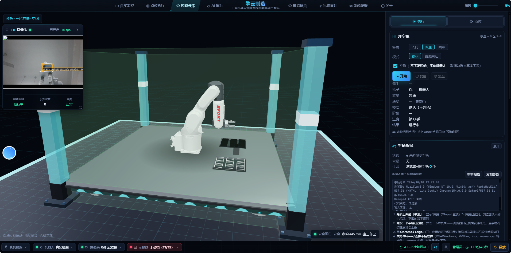
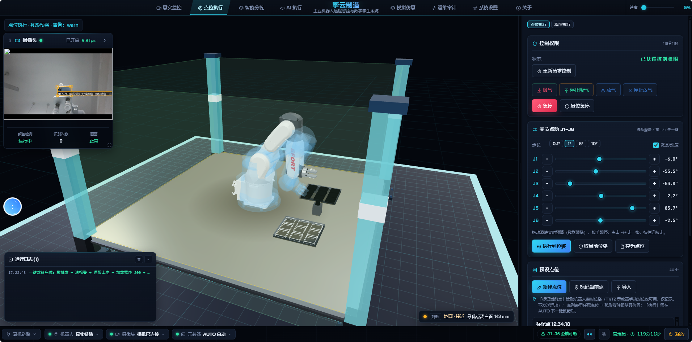
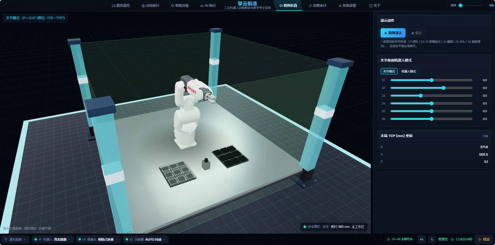

# EfortSimulationRobot

埃夫特 **ER8-700H** 六轴工业机器人 · **全栈网页端三维实时监控与仿真系统**。

> **接手开发 / 让 AI 上手 → 先读 [`AGENTS.md`](AGENTS.md)**：三步跑起来 · 代码地图 ·
> 常用命令 · **硬口径与禁区**（真机安全、控制链路、判色口径 —— 都是现场踩过的坑）。

> **关于本项目（About）**：基于 Modbus TCP 读取真实控制器数据、用 Three.js 按官方 DH 参数驱动
> **STEP 数模导出的 GLB**，在浏览器里 1:1 还原机器人并实时跟随；支持关节 / 机器人（笛卡尔六自由度）
> 双模式操控、点位与程序执行、轨迹录制入库、**数字孪生残影预演**、工业安全围栏四级报警、
> **七色视觉分拣**与**自然语言（对话式）控制**。
> 视觉以 **USB 摄像头（OpenCV）为主**，默认**不启用海康工业相机、不启用 YOLO**；换机型/换后端只改配置。
> 后端 FastAPI + WebSocket，前端 Vue3 + Pinia + Three.js，相机 / 视觉是一个独立进程（MJPEG 推流）。

### 真实界面截图（现场运行）

| 页面 | 说明 |
|---|---|
|  | **智能分拣**：颜色识别（七色调色板）＋ 相机实时画面（含识别框）＋ 数字孪生 1:1 跟随；左上为摄像头浮层，右下/右侧为分拣与井字棋执行面板 |
|  | **点位执行 · 残影预演**：下发前先跑一遍**半透明"残影"**预判轨迹，无碰撞／不变红才允许真正运动；右侧为控制权限、关节角点动与示教点位 |
|  | **模拟仿真**：演示动作、关节角／机器人模式滑块、末端 TCP 坐标；不连真机也能演示与验证运动学 |

### 官方数模与规格

| 项目图片 · ER8-700H 官方数模渲染与规格 | |
|---|---|
|  |  |
| **渲染主视图（ds_full）** | **左视图（ds_left）** |
|  |  |
| **右视图（ds_right）** | **底部视角（z_bottom）** |
|  |  |
| **运动范围图（motion range）** | **官方数据手册首页（PDF：[ER8-700H_datasheet.pdf](assets/cad/ER8-700H_datasheet.pdf)）** |

> 完整素材：`assets/cad/`（12 张图 + 2 份 PDF：数据手册 / 运动范围）。

后端通过 Modbus TCP 读取机器人关节角 (J1–J6) → 正运动学计算 TCP → WebSocket 实时推送；
前端用 Three.js 按 DH 参数驱动 **官方 STEP 数模导出的 GLB**，真实还原机器人形态并实时跟随。
> ⚠️ **不是纯只读系统**：默认（双闸关闭）只读不写；双闸打开后 `/api/control/*` 会真机下发。
> 完整的写入权限与安全约束见 [§8.2 写入权限与双闸](#82-控制--运动学-apicontrol)。
内置工业安全围栏（区域越界 + 地面碰撞四级报警）、实验室场景、离线模拟演示、录制回放与视觉检测。

---

## 〇、项目速览（About）

| 项 | 内容 |
|---|---|
| **名称** | EfortSimulationRobot |
| **对象** | 埃夫特 ER8-700H 六轴工业机器人（负载 8kg / 臂展 712mm，见 `config/robot.yaml` 与 `assets/cad/ER8-700H_datasheet.pdf`） |
| **形态** | FastAPI 后端(:8000) + Vue3/Three.js 前端 + 独立相机服务(:8100) + SQLite(WAL) |
| **通信** | Modbus TCP 192.168.1.12:502（读位姿为常态；写指令需"双闸 + 控制令牌"） |
| **三维** | 官方 STEP 数模 → GLB；按 DH 参数建立运动链；智能剖切 / 实验室场景 / 安全围栏 / 残影预演 |
| **操控** | 关节模式（J1–J6 滑条）/ 机器人模式（机器人坐标系六自由度 X/Y/Z + A/B/C，IK 整臂联动） |
| **视觉** | **USB 摄像头（OpenCV）为主**；`EFORT_CAMERA_KIND=usb`（默认）**不加载海康 MVS、不枚举**；YOLO 目标检测**默认关闭**；颜色识别为**纯 OpenCV**（HSV 色相分带 + CIE Lab / CIEDE2000 复核），可识别**七色**（红/橙/黄/绿/青/蓝/紫） |
| **判色口径** | **有效色由指令决定**：用户没提到的颜色 = 无效色 → **原路放回原位**（黑/无彩色永远是无效色） |
| **安全** | 围栏四级阈值(安全/接近/危险/碰撞) + 最低点离台面高度检测 + 双闸写入 + 控制令牌 + 急停 + 执行登记自愈 |

---

## 一、功能特性

| 模块 | 能力 |
|---|---|
| **真实监控** | Modbus TCP 常态读位姿（`ws_push_hz=20`）推送，关节角 + TCP + 速度实时显示；机器人离线时自动切换为前端本地演示（不中断画面） |
| **模拟仿真** | 6 轴滑条 + 键盘精确操控；关节/机器人两种操控模式（关节角 ↔ 世界坐标 XYZ/姿态）；正逆运动学预演；沙盘道具与跳舞演示 |
| **点位 / 程序执行** | 点位列表 / 示教滑块 / 逐点执行 / 连续点动；程序分步执行、本地文件执行、执行日志、**中止**；**下发前残影预演**（无碰撞才允许真正运动） |
| **数字孪生残影预演** | 下发前先跑一遍**半透明"残影"**预判整条轨迹，碰撞/越界会让残影变红并拒绝下发（`three/ghost.js`，回归 `verify_ghost.mjs`） |
| **智能分拣** | 三色方块分拣（A 区 3×3 取料 → C 检测判色 → B 区 3 列投放，第 1 列红 / 第 2 列绿 / 第 3 列蓝），38 点位体检、3D 同步、执行流程步骤条；**无效色原路放回**，不引入真空反馈硬件 |
| **AI 执行（对话式）** | 自然语言指令解析（`nl_intent.py` 规则 + `llm.py` 大模型兜底）→ 两段式"解析 → 执行"（同一 `plan_id`），首次进入默认**空跑**校验，确认词/停止词有专门回归；支持语音直执 |
| **井字棋对弈** | 机器人与人在 3×3 棋盘上真实落子（点位/ICON 复用分拣执行通道），有多难度与回放接口 |
| **视觉检测** | USB 相机 MJPEG 实时流 + 纯 OpenCV 颜色识别（可截图存档）；YOLO 目标检测按需加载、可一键释放内存；以**悬浮小面板**内嵌于「真实监控」右上角，可展开/收起 |
| **安全围栏** | 矩形 / 任意四边形 / 圆形多区域，各自**四级阈值**（安全/接近/危险/碰撞）；围栏越界 + 机器人最低点离台面高度双维度检测；玻璃墙、角柱、黄色警示带的完整工业化视觉；配置持久化 + 报警事件时间线 |
| **执行登记自愈** | 卡死的执行登记会被**自动清理**，界面另提供**手动复位**入口（`POST /api/control/force-release`）；只要还有**活着**的执行一律拒绝强清 |
| **实验室场景** | 车间房间（四面墙 / 天花板 / 灯带 / 点光 / 贴墙设备道具）+ 环氧自流平工作区 + 拉丝不锈钢设备站台 |
| **智能剖切** | 相机移到房间外侧或屋顶上方时，挡视线的那一面墙 / 天花板自动变半透明（不消失），其余保持实体 |
| **三维姿态平滑** | 真机 20Hz 的跳变被指数平滑成连续运动，视觉上不抖 |

---

## 二、系统架构

```text
                        ┌──────────────────────── 浏览器 (Vue3 + Three.js) ────────────────────────┐
                        │  真实监控 / 点位执行 / 智能分拣 / AI 执行 / 模拟仿真 / 运维审计 / 设置 / 关于   │
                        │  （3D 场景全局常显，用 v-show 切换 Tab，不重建、不闪断）                        │
                        └───────────────▲──────────────────────────────────┬──────────────────────┘
                                 WS 位姿 / 事件                       REST + WS（控制令牌）
                                        │                                  ▼
   ┌────────────────────────────────────┴────────────────────────────────────────────────────────┐
   │                              后端 FastAPI + uvicorn   :8000（同时托管前端 dist）             │
   │   services/modbus.py      读寄存器（失败 → 重连退避）                                          │
   │   services/kinematics.py  正运动学 FK → TCP 位姿                                              │
   │   services/collector.py   采样线程：入库(节流) + WebSocket 广播                                │
   │   services/motion.py      运动引擎（写路径 + 双闸 + 急停 + 执行登记）                          │
   │   services/rc_ready.py    就绪状态机（停机→清报警→伺服→加载→运行）                            │
   │   api/                    robot · control · sorting · ai · tictactoe · vision · safety · …     │
   │   db/  SQLite(WAL)        pose_history / system_events / sessions / recordings / safety_events │
   └───────┬──────────────────────────────┬────────────────────────────────┬──────────────────────┘
           │ Modbus TCP                   │ HTTP                            │ WebSocket
           ▼                              ▼                                 ▼
   ┌────────────────────┐        ┌──────────────────────┐         ┌──────────────────┐
   │ 机器人控制器        │        │ 视觉服务 :8100        │         │ 前端（浏览器）    │
   │ 192.168.1.12:502   │        │ USB 相机(OpenCV)      │         └──────────────────┘
   │ 40101 命令字        │        │ 七色识别 / 标定 / 记录 │
   │ 40103 速度          │        └──────────────────────┘
   │ 40135 触发位        │
   │ 常驻服务程序 210    │
   └────────────────────┘
```

> **关键机理**：PC 端只能"写目标数据 + 触发位"，真正的运动由控制器侧**常驻服务程序 210** 执行
> （点动 `MJOINT` / 吸放 IO）。所以"下发成功"不等于"动作完成"，必须看**完成位**。
> 又因控制器同一时刻只能加载运行一个程序，点动与吸放**合并写在同一个 210** 里（拆号会反复撞 5005）。

**端口占用**

| 端口 | 服务 | 必需 |
|---|---|---|
| 8000 | 后端 API + WebSocket + 前端静态托管 | 是 |
| 8100 | 视觉服务（USB 相机 + 颜色识别；YOLO 按需） | 否（摄像头面板需要） |
| 5173 | Vite 开发服务器 | 否（仅前后端分离开发时） |
| 502 | 机器人 Modbus TCP（外部设备） | 否（连不上自动回退模拟） |

---

## 三、环境要求

| 组件 | 版本 | 说明 |
|---|---|---|
| **Python** | 3.10+（实测 3.13） | 后端；`setup.bat` 自动建 `backend/.venv` |
| **Node.js** | 20+（实测 22） | 前端构建（Vite） |
| 操作系统 | Windows 10/11 | 启动脚本为 `.bat`；后端/前端本身跨平台 |
| 浏览器 | Chrome / Edge 现代版本 | 需支持 WebGL2 与 ES2020 |
| 相机 | 普通 **USB 摄像头** | 默认后端 `EFORT_CAMERA_KIND=usb`：**不启用**海康工业相机（MVS），无需安装 MVS 客户端 |

> 视觉服务用的是**另一套解释器**（默认参考项目 `EFORT_Camera_Python_OpenCv` 的 venv），
> 与后端 venv 分开。颜色识别是纯 OpenCV+numpy，**不依赖 torch**；
> 只有启用 YOLO 目标检测时才需要 `ultralytics`（会连带安装 PyTorch）。
> 海康 MVS 只在把 `EFORT_CAMERA_KIND` 改成 `auto` / `mvs` 时才需要。

---

## 四、快速开始

### 4.1 首次安装（一键）

双击根目录 **`setup.bat`**，它会依次完成：

1. 检查 Python / Node 是否就位（版本不达标会明确报错）
2. 创建 `backend\.venv` 并安装 `backend/requirements.txt`
3. 在 `frontend\` 安装 npm 依赖（有 lock 文件时用 `npm ci`）
4. 创建运行时目录 `data\` `logs\` `camera\captures\`
5. 构建前端到 `frontend\dist`
6. 若 `.env` 不存在，从 `.env.example` 复制一份

脚本幂等，可反复运行。

**环境自检**：双击 `scripts\doctor.bat`，逐项列出 PASS / WARN / FAIL 并给出修复提示。

### 4.2 启动

```bat
run.bat              清理旧进程 + 启动视觉服务 + 后端 + 打开浏览器(推荐)
run.bat backend      只启动后端 :8000
run.bat camera       只启动视觉服务 :8100
run.bat stop         停止 8000 / 8100 上占用端口的进程
run.bat build        重新构建前端
run.bat help         查看用法
```

浏览器访问 **http://localhost:8000**

`scripts\start_all.bat`、`scripts\start_backend.bat`、`scripts\start_camera.bat`、
`scripts\build_frontend.bat` 是等价的单功能入口，便于做快捷方式或计划任务。

### 4.3 开发模式（前后端分离，热更新）

```bat
scripts\start_backend.bat       终端 1：后端 :8000
scripts\start_frontend_dev.bat  终端 2：Vite :5173
```

打开 http://localhost:5173 —— Vite 已把 `/api` 与 `/ws` 代理到 8000，同源免 CORS。

### 4.4 构建产物

`frontend/dist` 由后端以 `no-store` 托管。改完前端执行 `run.bat build`，
浏览器**直接刷新**即可看到新版本（已禁用缓存，无需强刷）。

---

## 五、目录结构

```text
EFORT_Web_Monitoring/
├─ setup.bat                 一键安装（Python/Node 依赖 + 构建）
├─ run.bat                   一键启动 / 停止 / 构建
├─ .env.example              环境变量模板（复制为 .env 生效）
├─ config/
│   ├─ robot.yaml            ★ 唯一数据源：DH / 寄存器 / 采样 / 限位 / 运动 / 视觉参数
│   ├─ safety.json           安全围栏配置（运行时可改，原子写落盘）
│   └─ frames.json           坐标帧（工具/用户坐标系）标定
├─ backend/                  FastAPI 后端（独立 venv）
│   ├─ app/
│   │   ├─ main.py           入口：路由挂载 + 静态托管 + 生命周期 + CORS 白名单 / 体积上限 / 线程池 / 周期清理
│   │   ├─ api/              薄路由层：robot · control · sorting · ai · tictactoe · vision · safety ·
│   │   │                    points · programs · recordings · events · system · settings · frames ·
│   │   │                    auth · asr · gamepad · ws
│   │   ├─ core/             config / app_settings / deps / exceptions / logger / middleware /
│   │   │                    safety_config / safety_const / frames_config / brand
│   │   ├─ db/               models / database(引擎+WAL) / crud
│   │   ├─ schemas/          Pydantic 出入参（pose）
│   │   └─ services/         modbus · motion · jog · jog_frames · kinematics · limits · collector · hub ·
│   │                        events · safety_guard · rc_ready · runmode · sim_robot · camera_client ·
│   │                        vision_ingest · vision_rules · sorting · tictactoe · placement · nl_intent ·
│   │                        llm · asr_tencent · gamepad
│   ├─ scripts/init_db.py    手工建库
│   ├─ tests/                pytest 511 例（29 个文件；见「十、测试与回归」）
│   ├─ requirements.txt      运行依赖（支持范围）
│   ├─ requirements.lock     精确版本（部署/复现优先用它）
│   └─ requirements-dev.txt  附加 pytest / httpx
├─ camera/                   视觉服务（独立进程 + 独立解释器）
│   ├─ camera_service.py     标准库 http.server：MJPEG / 抓帧 / YOLO / 颜色线程
│   ├─ vision_color.py       ★ 七色识别算法（纯 OpenCV：HSV 色相带 + CIE Lab/CIEDE2000 复核）
│   ├─ tools/                vision_color_test / vision_e2e_replay / vision_replay_test / vision_service_test
│   ├─ models/               .pt 模型目录（YOLO 按需加载）
│   └─ captures/             截图输出（运行时生成；含 vision 颜色分拣存档）
├─ frontend/                 Vue 3 + Three.js
│   ├─ index.html            页面骨架 + 全部 CSS（深色工业主题）
│   ├─ vite.config.js        base "./" + dev proxy
│   ├─ public/models/        robot_full.glb ← 官方 STEP 数模导出件
│   ├─ src/
│   │   ├─ main.js           Vue 应用装配 + 全局未捕获错误收集
│   │   ├─ config.js         WS/API 地址推断（姿态流 / 事件流分开）+ 兜底 DH + 相机地址
│   │   ├─ App.vue           页面框架 / 报警条 / 语音播报 / 快捷键 / 事件流订阅
│   │   ├─ tabs.js · shortcuts.js · linkview.js · guide.js · brand.js
│   │   │                    ↑ 纯函数（导航权限 / 快捷键解析 / 状态灯取色 / 指引文案 / 品牌名）
│   │   ├─ three/            ★ 单场景 3D：manager(模型装配/平滑) · safety(围栏引擎+四级分级) ·
│   │   │                    lab(实验室+剖切) · cell(地坪+站台) · ghost(残影) · jointOwner ·
│   │   │                    simObjects · sortingBlocks(分拣料/托盘/相机) · endEffector · materials · sceneCoords
│   │   ├─ net/              control.js（带令牌的 API 封装）· ws.js（姿态流客户端）
│   │   ├─ ai/               对话式控制台：aiChat.js · confirmWords.js · speak.js
│   │   ├─ games/            tictactoe.js（纯逻辑）· gamepad.js
│   │   ├─ robot/            robotModel.js（官方数模装配自检）
│   │   ├─ sorting/          flowSteps.js（执行流程步骤条映射）
│   │   ├─ components/       （28 个）MonitorLayout · RealMonitor · SimMonitor · PointExecView ·
│   │   │                    ProgramExecView · SortingView · AiControlView · SettingsView · EventsView ·
│   │   │                    AboutView · RobotParamsCard · ExecControlCard · RcReadyCard · CameraPanel ·
│   │   │                    SafetyPanel · SafetyChip · StatusStrip · GuideBar · AnnouncePanel ·
│   │   │                    AsrSubtitle · TicTacToeCard · TicTacToeBoard · GamepadTestCard ·
│   │   │                    RobotProgramPanel · SimObjectsPanel · SortFlow · LinkPanel · Icon
│   │   ├─ stores/           （13 个 store + 1 个纯函数模块）robot · safety · camera · exec(执行域) ·
│   │   │                    auth(令牌) · link(自检轮询) · rcReady · settings · ui · sorting3d · tictactoe ·
│   │   │                    ai · asr + poseAuthority.js（姿态权威优先级，纯函数）
│   │   ├─ core/             safetyConst.js
│   │   └─ utils/            alarm(Web Audio 蜂鸣) / dance / jointScale(限位条宽) / safetyConfig /
│   │                        safetyLabels / xplParser
│   └─ tools/                ★ 无头回归脚本 25 个 verify_*.mjs + 2 个静态检查（npm run verify）
├─ scripts/                  doctor.bat · start_* · build_frontend · reg_survey.py
├─ docs/                     方案与实施记录文档（40+ 份）
├─ assets/cad/               官方手册 / 运动范围图 / 数模渲染图（12 图 + 2 PDF）
├─ programs/                 控制器程序（200 / 210 服务程序、411.XPL 等）
├─ tools/                    真机脚本与探针（scan_lan / rc_diag / probe_regs …，需禁代理）
├─ data/                     robot.db（运行时生成）
└─ logs/                     运行日志
```

---

## 六、配置

### 6.1 机器人配置 `config/robot.yaml`

机型相关的**唯一数据源**，换机型只改这一个文件：

| 段 | 作用 |
|---|---|
| `robot` | 型号 / 序列号 / 负载 / 臂展（信息展示） |
| `connection` | Modbus 主机、端口、unit_id、超时、`simulate`(auto/always/never) |
| `modbus` | 功能码、起始寄存器、数量、单位、字序（`swap` = 高字在后） |
| `axis_sign` | 6 轴符号，某轴方向与真机相反时改成 `-1`（全链路一致生效） |
| `joint_limits` | 关节行程限位（前端 clamp + 量程显示） |
| `dh` | **DH 参数**：`d / a / alpha / theta_offset`，决定三维形态与 FK 精度（含 `calibration_pending`） |
| `mounting` | 安装方式 `floor / wall / ceiling` |
| `sampling` | 读取频率、入库频率、推送频率、历史保留天数 |
| `database` / `server` | 库位置（可被环境变量覆盖）/ 监听地址端口 |
| `motion` | 写路径寄存器表、双闸 `real_write`、围栏互锁 `require_live_safety`、点动/真空参数、就绪程序白名单、轴锁 |
| `vision` | 相机服务地址、后端摄入周期与开关、保留天数 |

### 6.2 安全围栏 `config/safety.json`

运行时可改，通过 API 或界面「安全围栏」面板保存（原子写 + 强校验）。

```jsonc
{
  "enabled": true,
  "zones": [{
    "id": "z1", "name": "主工作区", "enabled": true,
    "shape": "rect",                 // rect | quad | circle
    "center": { "x": 0, "z": 0 },    // rect / circle 圆心
    "half":   { "x": 0.82, "z": 0.82 },  // rect 半宽(m)
    "radius": 0.9,                   // circle 半径(m)
    "corners": [[-0.82,-0.82], [-0.82,0.82], [0.82,0.82], [0.82,-0.82]], // quad 四个角点(m)
    "height": 1.2,                   // 围栏高度(m)
    "walls": true,                   // 该区域是否显示玻璃墙
    "posts": { "enabled": true, "size": 0.1, "color": "#f2c500" },
    "thresholds": {
      "basis": "halfwidth",          // halfwidth(中心到最近边) | fixed_mm(绝对值)
      "warn": 0.3, "danger": 0.1,    // 占用比例阈值
      "fixed_mm": 300.0              // basis=fixed_mm 时的基准
    },
    "colors":  { "safe": "#2ecc71", "warn": "#f2c500", "danger": "#e5484d", "hit": "#ff2020" },
    "opacity": { "safe": 0.11, "warn": 0.2, "danger": 0.3, "hit": 0.45 }
  }],
  "blink": { "hz": 4.0, "min": 0.18, "max": 0.63 },      // 碰撞闪烁
  "alarm": { "banner": true, "chip": true, "banner_min": "danger", "sound": false },
  "walls": true,                       // 全局玻璃墙总开关（关掉仍保留线框+角柱）
  "ground": {                          // 地面/台面碰撞检测
    "enabled": true,
    "warn_mm": 150, "danger_mm": 80, "hit_mm": 30,       // 必须满足 hit ≤ danger ≤ warn
    "colors":  { "warn": "#f2c500", "danger": "#e5484d", "hit": "#ff2020" },
    "opacity": { "warn": 0.2, "danger": 0.3, "hit": 0.45 }
  },
  "overlay": { "bbox": false },        // 显示围栏包围盒线框
  "camera":  { "position": [0,0,0], "target": [0,0,0] }  // 保存的视角
}
```

> **地面报警垫的形状跟随第一个启用区域的轮廓**（矩形/四边形/圆形均可），
> 机器人站在设备站台上时，零点自动对齐**台面**而非房间地坪，
> 读数含义是「机器人最低点离台面的高度」。

### 6.3 坐标帧 `config/frames.json`

工具/用户坐标系的标定数据（由 `/api/frames` 读写，"管理员"权限），用于点动与 TCP 表达。

---

## 七、环境变量

复制 `.env.example` 为根目录 `.env`。**已存在的系统环境变量优先，`.env` 不会覆盖它**；
不建 `.env` 时全部使用内置默认值。

| 变量 | 默认 | 作用 |
|---|---|---|
| `EFORT_SIMULATE` | `auto` | `auto` 连不上自动回退模拟 / `always` 强制模拟 / `never` 强制真机 |
| `EFORT_DB_URL` | `sqlite:///data/robot.db` | 覆盖数据库连接串（测试/部署用） |
| `EFORT_ADMIN_PASSWORD` | 无（未设则启动生成随机口令并打日志） | 管理员口令：换限时控制令牌（连接真机执行 / 急停 / 管理员操作前需） |
| `EFORT_OPERATOR_PASSWORD` | 空 | 操作员口令（选填）；设置后操作员令牌只能操控机器人，改不了围栏/备份/审计 |
| `EFORT_CONTROL_TTL` | `7200` | 控制令牌有效期（秒）；`0` = 不限时。现场口径 2 小时 |
| `EFORT_REAL_MOTION` | `0` | 真实下发总闸①；须与 `robot.yaml → motion.real_write: true` **同时**打开才写真机 |
| `EFORT_HOST` | `127.0.0.1` | **后端绑定地址**。默认只绑本机；要局域网访问改 `0.0.0.0` |
| `EFORT_THREAD_POOL` | `96` | 同步端点线程池上限。长任务(程序执行/一键就绪/AI 对话)会占 worker，改小请谨慎 |
| `EFORT_CAMERA_KIND` | `usb` | 相机后端：`usb`(**不启用海康工业相机**) / `auto`(有网口优先) / `mvs`(只用网口) |
| `CAMERA_PORT` | `8100` | 视觉服务端口 |
| `EFORT_CAMERA_HOST` | `127.0.0.1` | **视觉服务绑定地址**。默认只绑本机；要别的电脑访问改成 `0.0.0.0` |
| `EFORT_CAMERA_TOKEN` | 空 | 相机服务共享令牌（选填）。设了 → 写接口必须带 `X-Camera-Token` |
| `EFORT_CAMERA_MAX_STREAM` | `6` | MJPEG 并发上限（超限直接拒绝，不排队） |
| `EFORT_CAMERA_PYTHON` | 参考项目 venv | 跑视觉服务的解释器（需含 numpy/Pillow；启用 YOLO 时还需 torch/ultralytics） |
| `EFORT_MVS_SDK_DIR` | 参考项目 MvImport 路径 | 海康 `MvCameraControl_class.py` 目录（仅 `mvs`/`auto` 用） |
| `EFORT_MVS_RUNTIME_DIR` | MVS 标准安装路径 | MVS 运行时 DLL 目录（仅 `mvs`/`auto` 用） |
| `EFORT_MAX_BODY` | `8388608`（8 MB） | 请求体上限（覆盖现有最大合法载荷） |
| `EFORT_LOGS_DIR` | 缺省为 `logs/` | 日志目录；测试用它隔离，避免把 traceback 写进生产日志 |
| `EFORT_CAM_CONF` | `0.5` | YOLO 目标检测置信度（与颜色判据是两套） |
| `EFORT_CAM_COLOR_CONF` | `0.28` | 三色/七色识别置信度（颜色分拣用） |

**实时语音字幕（腾讯云 ASR，整条功能可选）**：`EFORT_ASR_PROVIDER`（留空=关闭）、
`EFORT_ASR_APPID`、`EFORT_ASR_SECRET_ID`、`EFORT_ASR_SECRET_KEY`、`EFORT_ASR_ENGINE`（默认 `16k_zh`）、
`EFORT_ASR_MAX_SEC`（单次上限，默认 600s）。密钥只放 `.env`（后端读取），**绝不下发浏览器**。

前端构建期变量放 `frontend/.env`（模板见 `frontend/.env.example`），改动后需重新构建：

| 变量 | 默认 | 作用 |
|---|---|---|
| `VITE_CAMERA_PORT` | `8100` | 前端请求视觉服务的端口 |
| `VITE_CAMERA_TOKEN` | 空 | 与后端 `EFORT_CAMERA_TOKEN` 一致时，页面侧 fetch 自动带令牌 |

---

## 八、API 一览

**门控图例**：`公开` = 无需令牌；`控制` = 限时控制令牌（`X-Control-Token`，`POST /api/auth/login` 取得）；
`管理员` = 控制令牌且角色为 admin；`+双闸` = 还需 `EFORT_REAL_MOTION=1` 且 `motion.real_write=true`（见 8.2）。

### 8.1 系统 / 姿态（`/api`、`/healthz`）

| 方法 | 路径 | 门控 | 说明 |
|---|---|---|---|
| GET | `/healthz` | 公开 | 存活探针（不依赖 DB / 机器人） |
| GET | `/api/version` | 公开 | 服务版本信息 |
| GET | `/api/health` | 公开 | 机器人连接状态、模拟标志、采样信息、WS 客户端数 |
| GET | `/api/meta` | 公开 | 机型 / DH / 标定状态 / 关节限位 |
| GET | `/api/pose` | 公开 | 当前姿态（关节角 + TCP + 时间戳） |
| GET | `/api/history?limit=500` | 公开 | 历史姿态 |
| GET | `/api/export/csv?limit=2000` | 公开 | 导出 CSV |
| GET | `/api/rc-status` | 公开 | 控制器寄存器快照（状态字 / 报警 / 程序号 / 伺服位） |
| POST | `/api/reconnect` | 控制 | 探测并重连 Modbus（真实 ↔ 模拟切换） |
| POST | `/api/ready` | 控制 +双闸 | 一键就绪：停机 → 清报警 → 伺服上电 → 加载 → 运行（挂起于 WAIT） |
| POST | `/api/ready/cancel` | 控制 +双闸 | 取消就绪（停止服务程序，可选下电伺服）。**界面上与"一键就绪"已合并为同一颗按钮** |

> ★ **就绪按钮已合并**：界面上只有**一颗**按钮，按 `rc-status` 的实时 `servoOn` **变脸** ——
> 未上电显示绿色「一键就绪」，已上电显示红色「取消就绪」（点击时先读实时伺服态再决定调 `/ready` 还是 `/ready/cancel`）。

### 8.2 控制 / 运动学（`/api/control`）

本组路由级默认要求控制令牌；其中 `/preview`、`/fk`、`/ik`、`/programs`、`/file-source` 挂在
**只读预演路由**（`router_ro`）上，属**公开**（只算不发）。

| 方法 | 路径 | 门控 | 说明 |
|---|---|---|---|
| GET | `/api/control/limits` | 控制 | 关节限位 + 可达半径 |
| POST | `/api/control/preview` | **公开** | **指令预演**：只算不下发，返回末端位姿与逐段校验 |
| POST | `/api/control/fk` | **公开** | 正运动学：关节角 → 末端位姿（机器人模式滑块当前值） |
| POST | `/api/control/ik` | **公开** | 逆运动学求解（纯计算） |
| GET | `/api/control/programs` | **公开** | 只读：programs 目录下可执行程序名 |
| GET | `/api/control/file-source` | **公开** | 只读：读程序文件文本内容 |
| GET | `/api/control/state` `/tcp` `/frames` | 控制 | 引擎状态 / TCP / 坐标帧 |
| POST | `/api/control/move` | 控制 +双闸 | 插值下发到目标位姿（或点位） |
| POST | `/api/control/run-file` | 控制 +双闸 | 执行本地程序 / 序列。**已异步化**：立即返回 `{ok, started, run_id, name, kind}` |
| GET | `/api/control/run-state` | 控制 | 取某次执行的进度与**最终结果**（`state.result`） |
| POST | `/api/control/run-cancel` `/run-pause` `/run-resume` | 控制 | 中止 / 暂停 / 继续执行 |
| GET / POST | `/api/control/seq` | 控制 | 读取 / 保存程序序列编辑器内容 |
| GET | `/api/control/files` | 控制 | 可按文件名执行的目标清单（数据库程序 / 点位 + programs JSON） |
| GET | `/api/control/scene-state` | 控制 | ★ **统一场景状态**：返回当前**在跑的那一个执行**的状态（供 3D 联动，任何页都可用） |
| POST | `/api/control/force-release` | 控制 | ★ **兜底复位**：只清"**已死**"的执行登记，**不写任何寄存器**；有活着的执行一律拒绝 |
| GET | `/api/control/locks` | 控制 | 诊断：谁占着执行锁、为什么"一键就绪被推迟" |
| POST | `/api/control/estop` `/estop/reset` | 控制 | 软件急停与复位（急停不看连接态，只看令牌） |
| POST | `/api/control/clear-error` | 控制 | 清除控制器报警（有报警且在跑则先停机再清） |
| POST | `/api/control/jog/step` | 控制 +双闸 | 增量点动（限位夹紧 + 回报 `limit_clamped`） |
| POST | `/api/control/jog/start` `/keepalive` `/stop` | 控制 +双闸 | 连续点动 + 死人开关（超时无保活自动停） |
| GET | `/api/control/jog` | 控制 | 点动状态 |
| POST | `/api/control/vacuum` | 控制 | 吸气 / 停止吸气 / 放气（写 40135 触发位，经常驻程序 210 执行） |
| GET / POST / DELETE | `/api/control/run-mode` | 控制 | 示教器档位查询 / 声明 / 撤销 |

> ★★ **`run-file` 异步化（2026-10-10 评审 B1 根治）**：
> 请求内只做**解析/校验**（保持 404 + 候选列表的同步语义），校验通过就起后台线程执行、**立即返回 `run_id`**。
> 前端改从 `GET /api/control/run-state` 的 `state.result` 取**逐步结果** ——
> 旧的"响应体里直接带 `steps`"写法**已作废**。
> 目的是不再让一次几分钟的程序执行长期占住线程池（否则"整个网页转圈点不动"）。

> #### ⚠️ 写入权限与「双闸」
>
> `/preview`、`/fk`、`/ik` 等是**纯计算**，不写控制器；但本系统**并非整体只读** —— 上表标 `+双闸` 的接口
> 会写寄存器（Modbus FC6：`40101` 指令字、`40103` 速度、`40104` 程序号、
> `40135` 点动/吸放触发位、`40139~44` 目标角），另有 `POST /api/ready`、`/api/ready/cancel`、
> `POST /api/reconnect`、`POST /api/system/reconnect` 也是真机寄存器操作。
>
> **双闸**（`real_write_enabled()`，`services/motion.py`）—— 两者必须**同时**打开才写真机，
> 缺一即退回"只校验 + 记录"的安全模拟：
> 1. 环境变量 `EFORT_REAL_MOTION=1`；
> 2. `config/robot.yaml` → `motion.real_write: true`（或「设置 → 启用真实下发」，需重启后端）。
>
> 另外：所有写接口还要求**限时控制令牌**，匿名请求一律 401/403；
> 围栏 / 坐标帧 / 视觉 / 设置里的高危项需要**管理员**令牌。
> 现场上线前请先确认这两道闸的实际取值（`.env` + `robot.yaml`），详见
> `docs/审计-项目代码审计与优化改进方案.md`。

### 8.3 鉴权（`/api/auth`）

| 方法 | 路径 | 门控 | 说明 |
|---|---|---|---|
| POST | `/api/auth/login` | 公开 | 校验管理员/操作员口令换限时控制令牌；**按 IP 限速**（失败超限 → 429） |
| GET | `/api/auth/status` | 公开 | 当前令牌 / 角色 / 剩余 TTL |
| POST | `/api/auth/logout` | 控制 | 释放令牌 |

### 8.4 点位 / 程序（`/api/points`、`/api/programs`）

| 方法 | 路径 | 门控 | 说明 |
|---|---|---|---|
| GET | `/api/points`、`/{pid}`、`/{pid}/export` | 公开 | 列表 / 详情 / 导出 |
| POST | `/api/points`、`/import`；PUT `/api/points/{pid}`；DELETE `/api/points/{pid}` | 控制 | 增改删与导入 |
| GET | `/api/programs`、`/{prid}`、`/{prid}/export` | 公开 | 列表 / 详情 / 导出 |
| POST / PUT / DELETE | `/api/programs`、`/{prid}` | 控制 | 增改删 |

### 8.5 录制（`/api/recordings`）

| 方法 | 路径 | 门控 | 说明 |
|---|---|---|---|
| GET | `` / `/{rid}` / `/{rid}/export` | 公开 | 列表 / 详情（含完整帧序列）/ 导出 JSON |
| POST | `` / `/import` | 控制 | 新建（带 `source`: `real` / `sim`）/ 导入 JSON |
| PUT / DELETE | `/{rid}` | 控制 | 改名 / 更新 / 删除 |

### 8.6 安全围栏（`/api/safety`）

| 方法 | 路径 | 门控 | 说明 |
|---|---|---|---|
| GET | `/api/safety`、`/default`、`/versions`、`/{vid}` | 控制 | 读配置 / 出厂默认 / 版本历史 |
| POST | `/api/safety/validate` | 控制 | 只校验不落盘 |
| PUT | `/api/safety` | 管理员 | 保存（原子写 + 强校验，非法返回 `SAFETY_CONFIG_INVALID`） |
| POST | `/api/safety/reset`、`/versions/{vid}/rollback` | 管理员 | 恢复出厂 / 回滚版本 |
| GET / POST / DELETE | `/api/safety/events` | 控制 / 控制 / 管理员 | 报警事件时间线 / 追加 / 清空 |
| POST / GET | `/api/safety/live` | 控制 / 公开 | 围栏余量实时上报 / 读取 |

### 8.7 审计事件（`/api/events`）

| 方法 | 路径 | 门控 | 说明 |
|---|---|---|---|
| GET | `/api/events`、`/stats` | 控制 | 时间线（可筛 category/level/actor/action/q/hours）/ 统计 |
| GET | `/api/events/export` | 管理员 | 导出（json / csv） |
| DELETE | `/api/events` | 管理员 | 清理审计事件（可只清 N 天前；防止操作员抹痕） |

### 8.8 系统 / 设置 / 坐标帧（`/api/system`、`/api/settings`、`/api/frames`）

| 方法 | 路径 | 门控 | 说明 |
|---|---|---|---|
| GET | `/api/system/health` `/guide` `/info` | 公开 | 健康 / 链路自检（TCP 探测带 TTL 缓存）/ 环境信息 |
| POST | `/api/system/reconnect` | 控制 | 重连控制器（真机寄存器操作） |
| GET | `/api/system/export` | 控制 | 导出配置/数据包 |
| POST | `/api/system/import` | 管理员 | 导入配置包 |
| GET | `/api/settings` `/live` `/summary` | 公开 | 配置描述 / 实时值 / 摘要 |
| PUT | `/api/settings`；POST `/apply` `/test` | 控制 | 改配置（高危项标 `admin=true`）/ 应用（部分需重启）/ 试连接 |
| POST | `/api/settings/reset` `/password` `/control-ttl` | 管理员 | 恢复默认 / 改口令 / 改令牌 TTL（会回写 `.env`） |
| GET | `/api/frames` `/verify` | 公开 | 坐标帧读取 / 校验 |
| PUT / POST | `/api/frames`、`/teach`、`/reset` | 管理员 | 坐标帧写入 / 示教 / 复位 |

### 8.9 视觉（后端代理 `/api/vision`）

| 方法 | 路径 | 门控 | 说明 |
|---|---|---|---|
| GET | `/status` `/last` `/image` `/card` `/records` `/stats` `/export` | 公开 | 状态 / 最新结果 / 画面 / 色卡 / 记录 / 统计 / 导出 |
| DELETE | `/records` | 管理员 | 清空记录 |
| POST | `/records/{rid}/review` | 管理员 | 人工复核 |
| POST | `/config` `/background` `/calibrate/gray` `/calibrate/sample` | 管理员 | 配置 / 白标定 / 灰卡白平衡 / 现场色卡采样 |
| GET / PUT | `/rules` | 公开 / 管理员 | 分拣规则读取 / 写入 |

### 8.10 分拣 / 井字棋 / AI / ASR / 手柄

| 方法 | 路径 | 门控 | 说明 |
|---|---|---|---|
| GET | `/api/sorting/points` `/state` `/blocks` | 控制 | 38 点位体检 / 分拣状态 / 方块摆位（供 3D） |
| POST | `/api/sorting/start` `/cancel` `/teach` `/goto` | 控制 | 开始 / 中止 / 示教 / 点名到位 |
| DELETE | `/api/sorting/point` | 控制 | 删除点位 |
| POST | `/api/tictactoe/start` `/move` `/stop` `/reset` | 控制 | 开始 / 落子 / 停止 / 复位 |
| GET | `/api/tictactoe/state` `/replay` | 控制 | 状态 / 回放 |
| POST | `/api/ai/parse` `/chat` `/exec` `/cancel` `/occ/reset` | 控制 | 解析（两段式①）/ 对话 / 执行（②，带同一 `plan_id`）/ 取消 / 占位复位 |
| GET | `/api/ai/state` `/config` | 控制 | 执行状态 / 配置（如大模型是否配置） |
| GET | `/api/asr/config` | 公开 | 语音字幕是否启用（**绝不下发密钥**） |
| WS | `/ws/asr` | 控制 | 音频上行 / 字幕下行代理 |
| GET | `/api/gamepad/state` | 公开 | 手柄状态（后端直读 XInput，只读免令牌；浏览器读不到手柄时的替代输入源） |

### 8.11 WebSocket

| 协议 | 路径 | 门控 | 说明 |
|---|---|---|---|
| WS | `/ws/pose` | 公开 | 姿态 / 寄存器快照推送（校验 `Origin`、单流上限） |
| WS | `/ws/events` | 控制 | **审计事件流**：连接后首条消息发 `{"type":"auth","token":"..."}`；令牌不进查询串（避免落访问日志），失败以关闭码 `4401` 断开 |

### 8.12 相机 / 视觉服务（独立进程 `:8100`）

| 方法 | 路径 | 说明 |
|---|---|---|
| GET | `/stream` | MJPEG 实时流（可含检测框 / 颜色框） |
| GET | `/snapshot` | 当前单帧 JPEG |
| POST | `/snapshot-save` | 保存到 `camera/captures/` |
| GET | `/status` | 状态（设备 / FPS / AI / 颜色线程 / 检测耗时 / 模型列表） |
| GET | `/models` `/devices` | 可用 `.pt` 模型 / 设备列表 |
| POST | `/open` `/close` | 打开 / 关闭相机（异步，前端轮询 `/status`） |
| POST | `/reconnect` `/switch` | 手动重连相机 / 切换设备 |
| POST | `/config` | 更新 YOLO 配置 `enabled / model / conf / imgsz` |
| POST | `/unload` | 卸载 YOLO 模型并回收内存 |
| GET / POST | `/vision/status` `/vision/last` `/vision/records` `/vision/detect` `/vision/config` `/vision/background` `/vision/calibrate/*` `/vision/records/clear` | 颜色识别线程状态 / 最新触发 / 历史记录 / 同步调试 / 配置 / 静态背景 / 标定 / 清空 |

> 设了 `EFORT_CAMERA_TOKEN` 时，上表的**写接口**必须带 `X-Camera-Token`。

---

## 九、界面操作

### 9.1 顶部导航（8 个模块）

「没拿到权限就把它藏起来」由 `src/tabs.js` 纯函数决定，`tools/verify_tabs.mjs` 逐组合钉死；
**入口显隐只是体验，权限边界仍在后端**（`require_control` 401 / `require_admin` 403）。
数字键 `1`~`8` 对应**顶栏从左到右第 N 个可见模块**（没权限的不占位、序号顺延）。

| # | 模块 (key) | 门控 | 内容 |
|---|---|---|---|
| 1 | **真实监控** (`live`) | 公开 | 关节读数 + TCP 位姿 + 3D 实时姿态；离线时本地演示轨迹；右上角**摄像头悬浮面板**；左下参数卡 |
| 2 | **点位执行** (`point`) | 控制 | 点位列表 / 示教滑块 / 逐点执行 / 连续点动；右栏 tab 可在「点位执行 ↔ 程序执行」间切换 |
| 3 | **智能分拣** (`sort`) | 控制 | 38 点位体检、A/B/C 区、3D 同步、执行流程步骤条、井字棋对弈卡 |
| 4 | **AI 执行** (`ai`) | 控制 | 对话式自然语言控制台：解析 → 空跑校验 → 执行；可语音直执 |
| 5 | **模拟仿真** (`sim`) | 公开 | 6 轴滑条 / 世界坐标操控、指令预演、跳舞演示、沙盘道具 |
| 6 | **运维审计** (`ops`) | 管理员 | 审计事件时间线 / 统计 / 导出、围栏配置与版本回滚 |
| 7 | **系统设置** (`settings`) | 控制 | 机器人、连接、采样、数据库、安全、日志等配置（逐字段标注谁能改、是否要重启） |
| 8 | **关于** (`about`) | 公开 | 实验指导、快捷键、版本信息 |

> **「程序执行」(`program`) 是合法页面但不在顶栏出现**（与「点位执行」合并），
> 靠第 2 项的右栏 tab 条切换；刷新能恢复、权限照旧（`hidden: true`，见 `src/tabs.js`）。

底部常驻：**状态片**（运行日志 / 摄像头 / 示教器档位 / 真机链路，2026-10-11 起"机器人"片已并入"真机链路"片）+ 自检引导条 + 控制权限与语音播报开关。

#### 摄像头悬浮面板（真实监控右上角）

- ★ **相机与「实时捕捉」默认都关**（2026-10-11 口径）：启动项目**不再自动打开相机**。
  相机由用户自行点面板「开启相机」打开；「实时捕捉」（真实监控页右栏开关）控制**本页是否实时抓取画面**。
  两者**都不需要控制权限**即可手动开/关；**拿到控制权限后自动开启两者**（幂等，不重复发请求）。
  关闭「实时捕捉」会**真正停流**（释放 MJPEG 连接），不是只隐藏画面。
- 默认**收起**：只显示小画面缩略图 + 状态点 + 帧率，不占地方；
- 点标题栏**展开**：显示完整控制 —— 打开/关闭相机、↻ 重连相机、启用 YOLO 检测、
  模型选择、置信度/推理尺寸调节、截图存档、释放模型内存；
- 相机画面统一按比例缩放（`object-fit: contain`），不放大不裁切；
- 相机服务（`:8100`）由 `run.bat` 或 `run.bat camera` 启动，服务未运行时界面会提示。

### 9.2 快捷键

唯一事实来源是 `src/shortcuts.js`（`SHORTCUTS`），界面提示与「关于」页都读它；
解析规则由 `tools/verify_shortcuts.mjs` 逐上下文钉死。**任何页面生效，除非另有说明**。

| 按键 | 分组 | 作用 | 需令牌 |
|---|---|---|---|
| `1` ~ `8` | 导航 | 从左到右切到第 N 个**可见**模块（无权限的模块不显示，序号顺延） | 否 |
| `E` | 视图 | 展开 / 收起侧面板 | 否 |
| `Q` | 视图 | 显示 / 隐藏摄像头画面 | 否 |
| `空格` | 执行 | 运行 / 停止程序（**仅「程序执行」页**；空闲时重复运行上一次跑过的那一个） | 是 |
| `Esc` | 安全 | **急停**：立即停止一切运动并锁定（有弹层时先关弹层；不弹二次确认） | 是 |
| `Enter` | 安全 | 复位急停（需**先处于**急停锁定，避免误触） | 是 |

> 两条硬规则：① 焦点在输入控件里时，字母键与空格**一律不劫持**；
> ② 带 `Ctrl` / `Alt` / `Meta` 的组合键一概不抢（那是浏览器与系统的）。

### 9.3 安全围栏面板

在任意视图右侧，可实时调整区域形状/尺寸/阈值、四级颜色与透明度、
地面碰撞阈值、报警方式（横幅/状态片/蜂鸣）、视角存取，并查看报警事件时间线。
改动**即时生效**并在 3D 场景中同步；未保存时面板显示 `dirty` 标记。

---

## 十、测试与回归

### 10.1 前端（无头，无需浏览器）

```bat
cd frontend
npm run check     只跑两项静态检查（导入守卫 + 中文引号守卫）
npm run verify    静态检查 + 全部 25 个回归套件（verify_*.mjs）
npm run build     静态检查 + vite 生产构建
```

**静态检查（`check_*`）**

| 套件 | 覆盖 |
|---|---|
| `check_imports.mjs` | **静态导入守卫**：用了别的文件 `export` 的常量却没 import（vite build 不会报错，只在浏览器炸） |
| `check_cjk_bare.mjs` | **引号守卫**：中文文案串里混入 ASCII 引号导致的 SyntaxError（整页白屏） |

**回归套件（`verify_*`，共 25 个，均在 `npm run verify` 中）**

| 套件 | 覆盖 |
|---|---|
| `verify_simobjects.mjs` | 沙盘道具 AABB 判定 / 推出（纯函数） |
| `verify_pose_authority.mjs` | **姿态权威模型**：优先级数学、`applyRobotPose` 唯一写者、死组件清理 |
| `verify_lab.mjs` | 房间尺寸 / 贴墙道具不穿墙不沉地 / 照明 / 智能剖切 |
| `verify_cell.mjs` | 站台几何 / 台面顶面高度 / 立足面零点（离地检测基准） |
| `verify_ground.mjs` | 四级分级边界 / 缺 `colors` 时的按状态兜底取色 / 报警垫形状 |
| `verify_safety.mjs` | 多边形间距 / 圆形间距 / 阈值迁移 / 逐面墙着色 |
| `verify_safety_text.mjs` | 报警条与状态片**共用同一份文案判据**、缺配置的安全回退 |
| `verify_official_model.mjs` | **官方数模装配自检**窗口 + `attach()` 提升顺序双路对照 + 零件归类 |
| `verify_kinematics.mjs` | 前端 three 链 vs 后端 FK 逐点对拍；`attach()` 保持世界变换 |
| `verify_sorting3d.mjs` | 分拣 3D：坐标映射与 DH 链逐点对上、方块贴台面不漂浮、状态映射、资源释放 |
| `verify_sortflow.mjs` | 执行流程条：后端每个 stage 字面量都有步映射、顺序与工艺一致 |
| `verify_tictactoe.mjs` | 井字棋纯逻辑 + 输入路径，并与后端 `tictactoe.py` 的 `WIN_LINES` 对拍 |
| `verify_aichat.mjs` | AI 对话确认词/停止词判定顺序、可执行指令提示真覆盖后端意图 |
| `verify_speed.mjs` | **速度口径守卫**：顶栏滑块下限 == 后端 `SPEED_MIN`、默认值不写死、下发点共用同一变量 |
| `verify_ghost.mjs` | 残影预演：包围盒量级、材质、不可拾取、逐帧收敛 |
| `verify_highlight.mjs` | 关节高亮零件集合互不相交（杜绝"悬停 J1 全身亮"） |
| `verify_tabs.mjs` | 导航权限门控 + `isKnownView`（手改 localStorage 塞垃圾值不崩） |
| `verify_ui.mjs` | 右侧栏宽度持久化迁移（损坏的 localStorage 不崩、回落默认） |
| `verify_robot_params.mjs` | 参数读数卡：位姿来源顺序、限位条宽只有一份、**只读守卫**（不许写机器人） |
| `verify_link.mjs` | 底栏三盏灯 `state → tone/label` 逐档钉死 + 项目名三处一致 |
| `verify_rc_ready.mjs` | 就绪卡：`rc-status` 走公开通道、`/ready` 带令牌、按钮禁用判据、图标名存在 |
| `verify_stores.mjs` | Pinia store 用法：getter 不带参 / 不空括号调用；只保留单颗"一键就绪"按钮 |
| `verify_ai.mjs` | AI 执行页：解析/执行两段式同一 `plan_id`、全走控制令牌、默认空跑、误识兜底 |
| `verify_shortcuts.mjs` | 快捷键解析矩阵（输入框不劫持、有弹层先关层、Esc/Enter 的上下文） |
| `verify_about.mjs` | 「关于」页：guide.js 的四份实验数据**确实被渲染** |

> 另有几个**量测/预览工具**（不进 `verify` 链，人工跑）：`measure_clearance.mjs`（离地间隙分布）、
> `measure_layout.mjs`（房间/站台/机器人/报警垫几何体检）、`measure_end_effector.mjs`（末端尺寸）、
> `preview_sorting3d.mjs`（分拣 3D 真实摆位核对）。

> `npm run build` **已内置**静态检查：缺 import / 引号不配对会在构建阶段就失败
> （rollup 把未声明标识符当全局变量，vite build 本身不会报错）。

### 10.2 后端（`pytest`，**实测 511 例 / 29 个文件**）

```bat
cd backend
.venv\Scripts\python.exe -m pytest -q
```

> ★ 测试在 `conftest.py` 导入 app **之前**强制 `EFORT_SIMULATE=always` + `EFORT_REAL_MOTION=0`
> + 临时 `EFORT_DB_URL` + 临时 `EFORT_LOGS_DIR`，并把单例 Modbus 指向不可达端口 ——
> 无论本机 `.env` 怎么写，测试都**不会连真机、不会写真机、不会污染运行库、不会把 traceback 写进生产日志**。

| 文件 | 例数 | 覆盖 |
|---|---:|---|
| `test_ai.py` | 48 | AI 解析/意图/大模型 sanitize/库存问答 |
| `test_ai_chat.py` | 6 | 对话式控制台 |
| `test_ai_takeover.py` | 11 | AI 接管执行 |
| `test_api.py` | 15 | 路由形状 / 错误格式 / 只读端点 / 鉴权头 |
| `test_asr.py` | 19 | 语音字幕配置与代理 |
| `test_audit_p0.py` | 32 | **审计回归钉**：P0 与 P1-A/B/C/D 各项修复行为 |
| `test_auth_ttl.py` | 15 | 登录、令牌 TTL、角色、登出 |
| `test_gamepad.py` | 8 | 手柄状态读取 |
| `test_jog.py` | 16 | 点动门 / 增量 / 限位夹紧 / 看门狗 / 急停与围栏拦截 |
| `test_kinematics.py` | 6 | 正逆运动学一致性 |
| `test_limits.py` | 8 | 关节限位 |
| `test_log_isolation.py` | 5 | 测试日志与生产隔离 |
| `test_nl_intent.py` | 38 | 自然语言指令解析规则 |
| `test_ops.py` | 19 | 运维接口（健康、导出、配置读写） |
| `test_placement.py` | 12 | 摆放/占位逻辑 |
| `test_points_exec.py` | 7 | 点位 / 程序 / 执行链路 |
| `test_ready_servo_timing.py` | 7 | 就绪流程伺服上下电时序 |
| `test_run_recovery.py` | 7 | 执行登记自愈 / 卡死清理 |
| `test_runmode.py` | 23 | 示教器档位声明与自动确认 |
| `test_safety_api.py` | 13 | 围栏配置校验、版本归档与事件接口 |
| `test_safety_redline.py` | 17 | 安全红线（轴锁口径、真机写闸） |
| `test_security_hardening.py` | 12 | 安全加固（CORS、体积上限、限流等） |
| `test_seq_editor.py` | 24 | 程序序列编辑器六类操作 |
| `test_settings.py` | 25 | 界面配置表：合并语义、只读项原因、重启项 |
| `test_sim_robot.py` | 6 | 有状态仿真 |
| `test_sorting.py` | 58 | 分拣：38 点位、判色投票、选槽、占位表 |
| `test_tictactoe.py` | 15 | 井字棋纯逻辑 |
| `test_tictactoe_api.py` | 18 | 井字棋接口 |
| `test_vision.py` | 21 | 视觉服务接口与规则 |
| **合计** | **511** | 全部通过（`EFORT_SIMULATE=always`，不连真机） |

> 基线数会随代码增长；**改完必须重跑并同步本表**（文档与实际不符正是审计 P1-E6 记的问题）。

### 10.3 视觉（相机侧，需相机 venv）

```bat
%CAM_PY% camera\tools\vision_color_test.py     REM 合成图：算法逻辑（旋转不变、门槛开关、边界）
%CAM_PY% camera\tools\vision_e2e_replay.py 40  REM ★ 现场真图：整条链路（改阈值前必跑）
```

> **判色阈值只能按现场实测值定，不能按合成图定**（合成图 fill≈0.95+，现场真矩形只有 0.67~0.75）。
> `%CAM_PY%` = 相机 venv 的 python（`EFORT_CAMERA_PYTHON`）。

---

## 十一、部署

### 11.1 单机交付（推荐）

`setup.bat` → `run.bat`。后端同时托管前端静态资源，**只需开放 8000**。

### 11.2 局域网访问

> ★★ **2026-10-10 起：后端与视觉服务默认只绑 `127.0.0.1`**（原来都是 `0.0.0.0`）。
> 视觉服务**本身没有任何鉴权**，绑全网等于把"开/关相机、改判色阈值"摊给整个局域网。

要从**别的电脑**访问，必须**显式**放开：

```bat
REM .env 中设置
EFORT_HOST=0.0.0.0
EFORT_CAMERA_HOST=0.0.0.0
REM 并强烈建议同时设相机共享令牌（否则读写画面/改判色无门槛）
EFORT_CAMERA_TOKEN=change-me-camera-token
```

前端 `frontend/.env` 里 `VITE_CAMERA_TOKEN` 与上面的 `EFORT_CAMERA_TOKEN` 保持一致（需重新构建）。
之后同网段其他机器访问 `http://<本机IP>:8000`；前端会按当前页面的 hostname 拼 8100 地址。

Windows 防火墙放通示例（管理员 PowerShell）：

```powershell
New-NetFirewallRule -DisplayName "EFORT Web 8000" -Direction Inbound -Protocol TCP -LocalPort 8000 -Action Allow
New-NetFirewallRule -DisplayName "EFORT Vision 8100" -Direction Inbound -Protocol TCP -LocalPort 8100 -Action Allow
```

### 11.3 开机自启

把 `run.bat` 的快捷方式放入 `shell:startup`，或在任务计划程序中新建「登录时」触发的任务，
程序填 `run.bat`、起始位置填项目根目录。

### 11.4 停止

`run.bat stop` 会结束占用 8000 / 8100 的进程。

---

## 十二、故障排查

| 现象 | 排查 |
|---|---|
| 页面打不开 | 先跑 `scripts\doctor.bat`；确认 8000 在监听、`frontend\dist\index.html` 存在 |
| 界面改了但页面没变 | `run.bat build`，然后**普通刷新**即可（静态资源已 `no-store`） |
| 3D 里是方块模型不是真机外观 | 官方 GLB 加载或**装配自检失败**已回退程序化模型。按 F12 看 Console |
| 关节角一直不变 / 显示"模拟" | 机器人未连通。检查 `config/robot.yaml` 的 host/port、网线是否在 `192.168.1.x` 网卡；`EFORT_SIMULATE=always` 时为预期行为 |
| 姿态与真机方向相反 | 改 `config/robot.yaml` 的 `axis_sign` 对应位为 `-1` |
| 别的电脑访问不了 | 默认只绑 `127.0.0.1`；按 §11.2 显式设 `EFORT_HOST=0.0.0.0`（视觉另需 `EFORT_CAMERA_HOST`） |
| 视觉 Tab 提示"相机服务未启动" | 未启动 8100 服务，或端口被 `CAMERA_PORT` 改了；`run.bat camera` 启动 |
| 相机打不开 | 检查是哪个相机：默认 `usb`（普通 USB 摄像头）。只有一个实例能持有相机，端口被占用说明它已在跑 |
| 视觉服务内存涨到数 GB | 仅当启用 YOLO 时 torch 常驻属正常。点「释放模型内存」会卸载模型并裁剪工作集 |
| "一键就绪被推迟" | 说明有点动/下发正在执行（**正确拦截**）。查 `GET /api/control/locks` 看谁占着执行锁 |
| 执行卡住、手动指令点不动 | 界面上的**手动复位**（`POST /api/control/force-release`）会清掉**已死**的执行登记（不写寄存器）；若还有活着的执行，先用「停止执行」/「取消就绪」 |
| 后端日志 `database is locked` | 已启用 WAL + `busy_timeout`；若仍出现，检查是否有别的进程独占 `data/robot.db` |
| `.env` 不生效 | 同名**系统环境变量优先级更高**；`doctor.bat` 会打印实际生效值 |
| 真机脚本报 502 | 本机 shell 有 HTTP 代理会把 `127.0.0.1` 也代理掉；用 `curl --noproxy '*'` 或设 `no_proxy=127.0.0.1` |

---

## 十三、数模与标定状态（已知限制）

> 本节与 [`AGENTS.md`](AGENTS.md) §7「已知限制」逐条对齐。

| 限制 | 说明 |
|---|---|
| 料尺寸未卡尺实测 | 现按 70×70×14mm 画（受实测列距 85~105mm 限制，不能再大） |
| 末端工具真实长度未知 | 决定"料面该多高"；现按"坐台面"画（不悬浮） |
| 判色阈值需现场标定 | 现 0.55（来自现场实测最低 0.67） |
| 七色中「橙/黄/青/紫」无色卡实测 | 用理论色相带；红/绿/蓝的带按现场实测校准（**三色不动**），其余待现场实物复核 |
| 「黑」的判据（暗 **且** 不艳） | `dark_chroma_max=12` / `dark_s_max=80` 取自现有真图；待现场 C 位黑块整帧复核 |
| 工件的夹持/落料状态是**流程推断** | 现场**没有真空传感器**，3D 里会如实标注为推断 |
| 同步端点线程池 | `/control/run-file` 已**异步化**（立即返回 run_id，逐步结果从 `/control/run-state` 的 `state.result` 取）；线程池仍保持 96 兜底 |
| `motion._exec_lock` 跨"等完成位" | **复核后决定不改**：`command()` 本来就是快速失败（不是排队），锁内那段等待可被急停/看门狗打断；要分段就得改安全互锁 —— **收益小、风险大** |

### 13.1 官方数模

`frontend/public/models/robot_full.glb` 由官方 STEP 数模转换而来，
按 DH 关节轴拆分为 6 个连杆 + 底座，并挂了 EFORT 红色标识。
装配完成后会做**几何自检**（高/前后跨度/左右跨度/底面高度四项），
任一项超窗即视为装配错误：**卸掉半成品 → 回退程序化模型 → 控制台告警**，
保证页面永不出现"散架"的官方模型。用 `frontend/tools/verify_official_model.mjs` 可离线复核。

### 13.2 DH 标定

`config/robot.yaml` 中：

- **已实测可信**：`a1=49.5932`、`a2=330.1834`、`a3=40.2714`、`d2=0.2852`、`d4=329.2414`（来自装箱标定表）
- **仍为估算**：`d1`（基座高，现 376.0 取自运动范围图）、`d6`（腕长，现 80.0）、部分 `alpha` 角 —— `calibration_pending: true`

校准步骤：

1. 从埃夫特官网下载中心下载《ER8-700H 机器人数模》《运动范围图》《机械使用维护手册》，放入 `assets/cad/`。
2. 用运动范围图/手册核对 `d1`、`d6` 与 `alpha`，更新 `config/robot.yaml`。
3. 用全 0°、J1=90°、J4=90° 等已知姿态做目视交叉校验。
4. 前后端 DH 必须同步：前端 `src/config.js` 的 `FALLBACK_DH` 是 `/api/meta` 不可用时的兜底值。
5. 回归验证：`npm run verify`（含 three 链与后端 FK 的逐点对拍）。

---

## 十四、技术栈

**后端**：Python 3.13 · FastAPI · uvicorn · SQLAlchemy 2.0 · SQLite(WAL) · websockets · numpy · PyYAML
**前端**：Vue 3 (`<script setup>`) · Pinia · Vite · Three.js · Web Audio
**视觉**：OpenCV（HSV 色相带 + CIE Lab/CIEDE2000 判色，纯 CPU）· numpy · Pillow；
可选 **Ultralytics YOLO (PyTorch)** 目标检测（默认关闭）· 可选海康 MVS SDK（默认不启用）
**语音**：腾讯云实时语音识别（ASR，可选）
**三维**：官方 STEP → GLB（`step-to-glb` 流程，基于 occt-import-js / OpenCascade WASM）
